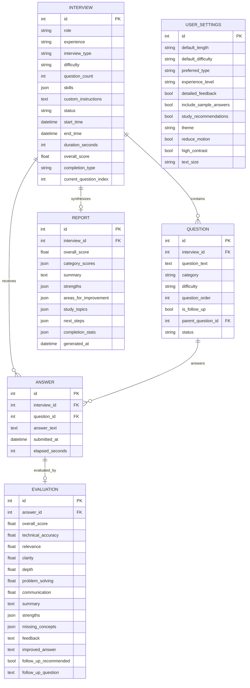

# Mock Interview Assistant — AI-Powered Technical & Behavioral Interview Platform

A full-stack, AI-powered Mock Interview Assistant built with **FastAPI**, **React 19**, **Tailwind CSS**, and **SQLAlchemy with SQLite**. The system features an advanced 3-tier Prompt Engineering architecture that dynamically generates role-specific interview plans, evaluates candidate responses across a 6-dimensional rubric, asks adaptive follow-ups, calibrates question difficulty in real time, and synthesizes comprehensive performance reports.

---

## 1. Project Overview

Preparing for technical and behavioral interviews requires realistic question framing, objective evaluation against structured rubrics, and adaptive follow-up scrutiny. This platform transforms static mock question sets into an interactive, stateful, backend-driven mock interview pipeline.

The frontend is based on the original Figma Make design with hand-crafted SVG graphics created in Claude. The Python backend powers all interview state machines, evaluation pipelines, session persistence, and analytics.

---

## 2. Features

- **Dynamic Role-Specific Question Generation**:
  - Calibrates questions to chosen role (Software Developer, Frontend, Backend, Full Stack, Data Analyst, Data Scientist, AI/ML Engineer, etc.), experience level, difficulty, and required skills.
  - Generates diverse categories: Technical Knowledge, System Design, Problem-Solving, Scenarios, and Behavioral (STAR).
- **Interactive, Stateful Interview Flow**:
  - One-question-at-a-time backend-driven state machine.
  - Active timing and character counting with shortcut submission (`Ctrl + Enter`).
  - Question skipping and early termination options that preserve completed answers.
- **Adaptive Questioning & Follow-Up System**:
  - Evaluates every answer before picking the next interaction.
  - Dynamically triggers targeted follow-up questions when candidates leave intriguing concepts or ambiguities unelaborated.
  - Automatically adjusts difficulty upward when candidate demonstrates sustained excellence (>85%).
- **Objective 6-Dimensional Rubric Evaluation**:
  - Scores 6 dimensions (0–10): Technical Accuracy, Relevance, Clarity, Depth, Problem-Solving, Communication.
  - Generates overall score (0–100), key strengths, missing concepts, constructive feedback, and an exemplary suggested improved answer.
  - Prompt injection protection prevents candidate answers from hijacking system prompts.
- **Comprehensive Final Reports**:
  - Visual score ring (KaTeX / SVG), category breakdown progress bars, strengths, focus areas, question-by-question review, study recommendations, and prioritized next steps.
  - Reports persist in SQLite and are accessible from session history.
- **Live Analytics & History Dashboard**:
  - Real calculations for interviews completed, average score, highest score, total practice time, score progression, skill breakdown radar, and interview type distribution.
  - Full search, filter, and sorting on real SQLite database records with empty states when no data is recorded.
- **Academic Prompt Engineering Comparison**:
  - Dedicated interactive comparison tool between Prompt Version 1 (Baseline), Version 2 (Rubric-Based), and Version 3 (Context-Aware Adaptive).
  - Live testing interface allowing users to run sample answers against each prompt version and observe comparative score and feedback fidelity.
- **Persistent User Settings**:
  - Configurable interview length, difficulty, type, accessibility (high contrast, reduced motion, text scaling), and themes (dark, light, system).

---

## 3. Technology Stack

### Frontend
- **Framework**: React 19 (`react`, `react-dom`)
- **Build Tool**: Vite 8 (`@vitejs/plugin-react`)
- **Styling**: Tailwind CSS v4 (`@tailwindcss/vite`) with custom CSS variable theme engine
- **Typography & Icons**: Inter & Manrope typography, custom SVGs for AI Orb states, Line Charts, Radar Charts, Donut Charts, and Completion checks

### Backend
- **Framework**: FastAPI (Python 3.10+) with Uvicorn
- **Database**: SQLite with SQLAlchemy 2.0 ORM
- **Validation**: Pydantic v2 & Pydantic Settings
- **AI SDKs**: Official Google GenAI SDK (`google-genai`), OpenAI SDK (`openai`), and deterministic fallback engine for offline testing
- **Testing**: Pytest with HTTPX TestClient and in-memory SQLite

---

## 4. Architecture & Folder Structure

```text
Totem/
├── .gitignore
├── README.md
├── backend/
│   ├── app/
│   │   ├── main.py                          # FastAPI entrypoint, CORS, lifespan & error handlers
│   │   ├── config.py                        # Pydantic Settings & environment variables
│   │   ├── database.py                      # SQLAlchemy engine, session maker, get_db
│   │   ├── models/                          # Database models
│   │   │   ├── __init__.py
│   │   │   ├── interview.py                 # Interview session model
│   │   │   ├── question.py                  # Question model
│   │   │   ├── answer.py                    # Answer model
│   │   │   ├── evaluation.py                # Rubric evaluation model
│   │   │   ├── report.py                    # Comprehensive report model
│   │   │   └── user_settings.py             # User preferences model
│   │   ├── schemas/                         # Pydantic v2 serialization schemas
│   │   │   ├── __init__.py
│   │   │   ├── interview.py
│   │   │   ├── question.py
│   │   │   ├── answer.py
│   │   │   ├── report.py
│   │   │   ├── analytics.py
│   │   │   └── settings.py
│   │   ├── prompts/                         # Prompt Engineering System
│   │   │   ├── __init__.py
│   │   │   ├── question_generator.py        # Question generation prompt builders
│   │   │   ├── interviewer.py               # System instruction prompt builders
│   │   │   ├── evaluator.py                 # Answer evaluation prompt builders
│   │   │   ├── followup.py                  # Adaptive follow-up prompt builders
│   │   │   ├── report_generator.py          # Final report synthesis prompt builders
│   │   │   └── versions/
│   │   │       ├── __init__.py
│   │   │       ├── v1.py                    # Baseline prompt
│   │   │       ├── v2.py                    # Rubric-based prompt
│   │   │       └── v3.py                    # Context-aware adaptive prompt
│   │   ├── services/                        # Business logic services
│   │   │   ├── __init__.py
│   │   │   ├── ai_service.py                # Configurable LLM provider service
│   │   │   ├── question_service.py          # Question plan creation & management
│   │   │   ├── evaluation_service.py        # Rubric evaluation execution
│   │   │   ├── adaptive_interview_service.py# Stateful progression, follow-ups & adaptation
│   │   │   ├── report_service.py            # Synthesis & formatting of final reports
│   │   │   └── analytics_service.py         # Real dashboard metrics calculations
│   │   ├── routes/                          # FastAPI REST endpoints
│   │   │   ├── __init__.py
│   │   │   ├── interview_routes.py          # /api/interviews
│   │   │   ├── question_routes.py           # /api/interviews/{id}/(current-question|skip)
│   │   │   ├── answer_routes.py             # /api/interviews/{id}/answers
│   │   │   ├── report_routes.py             # /api/interviews/{id}/report
│   │   │   ├── analytics_routes.py          # /api/analytics/*
│   │   │   ├── settings_routes.py           # /api/settings
│   │   │   └── prompt_routes.py             # /api/prompts/* (academic comparison)
│   │   └── utils/
│   │       ├── __init__.py
│   │       ├── dates.py                     # SQLite-compatible UTC datetime helpers
│   │       ├── json_parser.py               # Robust markdown JSON extraction
│   │       └── validation.py                # Prompt injection protection & sanitization
│   ├── tests/                               # Comprehensive Pytest test suite
│   │   ├── conftest.py                      # In-memory test db & test client fixtures
│   │   ├── test_health.py                   # Health endpoint tests
│   │   ├── test_interview_flow.py           # End-to-end interview flow tests
│   │   ├── test_evaluation_and_security.py  # Prompt injection & evaluation tests
│   │   ├── test_analytics_and_settings.py   # Analytics & settings persistence tests
│   │   ├── test_prompt_versions.py          # Academic prompt comparison tests
│   │   └── test_full_comprehensive.py       # Input validation, errors, & filtering tests
│   ├── requirements.txt
│   ├── .env.example
│   └── .gitignore
└── Frontend/
    ├── src/
    │   ├── api.ts                           # Typed API service layer
    │   ├── types.ts                         # Complete TypeScript interfaces
    │   ├── App.tsx                          # Root application component & session routing
    │   ├── data.ts                          # Roles and fallback data
    │   ├── mockAi.ts                        # Fallback evaluation utilities
    │   ├── components/
    │   │   ├── Layout.tsx                   # App shell, navigation drawer, sidebar
    │   │   ├── UI.tsx                       # Buttons, Cards, Badges, Icons, Modals
    │   │   └── Visuals.tsx                  # Interactive AI Orb, Charts, Completion check
    │   └── pages/
    │       ├── DashboardSetup.tsx           # Overview dashboard & New Interview setup form
    │       ├── InterviewReport.tsx          # Live Interview screen & Comprehensive Report
    │       └── OtherPages.tsx               # History, Performance, Settings, Help, AI Works
    ├── .env.example
    ├── package.json
    └── vite.config.ts
```

---

## 5. AI Integration & Prompt Engineering System

### AI Provider Architecture
The AI integration is isolated in `backend/app/services/ai_service.py`. It supports:
1. **Google Gemini** (`google-genai` official SDK, e.g., `gemini-2.5-flash`, `gemini-1.5-flash`)
2. **OpenAI** (`openai` official SDK, e.g., `gpt-4o-mini`, `gpt-4o`)
3. **Offline / Fallback Provider**: Fully deterministic rule-calibrated fallback used for automated tests and offline development when no external API key is provided.

### Academic Demonstration — 3 Prompt Versions

| Version | Focus | Capabilities |
| :--- | :--- | :--- |
| **V1 — Basic** | Baseline Comparison | Role-aware baseline interviewer asking one question at a time and evaluating general answer relevance. |
| **V2 — Rubric-Based** | Objective Calibration | Evaluates responses across an explicit 6-dimension rubric (Technical Accuracy, Relevance, Clarity, Depth, Problem-Solving, Communication) with structured scoring (0–10). |
| **V3 — Adaptive** | Full Context Trajectory | Tracks conversation history, ongoing performance trajectory, difficulty calibration (Easy $\rightarrow$ Medium $\rightarrow$ Hard), intelligent follow-up gating, and prompt injection defense. |

---

## 6. Database Design



---

## 7. API Endpoints

### Health Check
- `GET /api/health`: Returns API version, database connectivity, and configured AI provider status.

### Interviews
- `POST /api/interviews`: Creates an interview session and triggers AI question generation.
- `GET /api/interviews`: Retrieves interview history with search, type filter, and sorting.
- `GET /api/interviews/{id}`: Retrieves current session details and question state.
- `POST /api/interviews/{id}/start`: Starts the session and activates Question 1.
- `POST /api/interviews/{id}/end`: Ends the interview early and generates a partial report.
- `DELETE /api/interviews/{id}`: Deletes an interview session.

### Questions & Progression
- `GET /api/interviews/{id}/current-question`: Retrieves the active question.
- `POST /api/interviews/{id}/skip`: Skips the question and advances progression.

### Answers & Evaluation
- `POST /api/interviews/{id}/answers`: Submits an answer, evaluates it against the rubric, adapts difficulty/follow-up, and returns the next question.
- `GET /api/interviews/{id}/answers`: Retrieves all answers and evaluations for the session.

### Reports
- `GET /api/interviews/{id}/report`: Retrieves the final assessment report.
- `POST /api/interviews/{id}/report/generate`: Generates or regenerates the report.

### Analytics
- `GET /api/analytics/overview`: Top-level dashboard cards and recent progression.
- `GET /api/analytics/progression`: Score progression series across sessions.
- `GET /api/analytics/categories`: Performance aggregated across the 6 skill categories.
- `GET /api/analytics/interview-types`: Distribution breakdown of practiced interview types.
- `GET /api/analytics/insights`: Strongest category, focus area, and recommended practice.

### Settings
- `GET /api/settings`: Retrieves persistent user settings.
- `PUT /api/settings`: Updates user settings.

### Prompt Engineering Demonstration
- `GET /api/prompts/comparison`: Metadata and quality benchmarks for V1, V2, and V3.
- `POST /api/prompts/test`: Runs a comparative evaluation on sample candidate input.

---

## 8. Installation & Setup

### Prerequisites
- Python 3.10+
- Node.js 18+ and `pnpm` (or `npm`)

### 1. Backend Setup

```bash
cd backend

# Create virtual environment (optional but recommended)
python -m venv venv
# Windows:
.\venv\Scripts\activate
# Linux/macOS:
# source venv/bin/activate

# Install dependencies
python -m pip install -r requirements.txt

# Create .env from template
cp .env.example .env
```

Edit `backend/.env` with your preferred AI provider:
```env
AI_PROVIDER=gemini
AI_MODEL=gemini-2.5-flash
GEMINI_API_KEY=your_gemini_api_key_here
```
*(If no API key is set, the application automatically uses the deterministic fallback engine, allowing full offline usage and zero-configuration testing).*

Run the backend server:
```bash
python -m uvicorn app.main:app --host 0.0.0.0 --port 8000 --reload
```
API Documentation is available at: `http://localhost:8000/docs`

### 2. Frontend Setup

```bash
cd Frontend

# Install dependencies
pnpm install

# Start Vite development server
pnpm dev
```
Open `http://localhost:5173` (or `http://localhost:8443` depending on port configuration).

---

## 9. Running Tests

Run the full automated test suite:

```bash
cd backend
python -m pytest -v
```

The test suite covers:
- API health and database connectivity
- Interview creation, validation, starting, and state progression
- Answer submission, rubric scoring, and question advance
- Adaptive follow-up insertion and difficulty adjustments
- Skipping questions and early interview termination
- Final report synthesis, category scores, and review items
- Prompt injection protection and input sanitization
- Dashboard analytics and SQLite user settings persistence
- Prompt version comparison (V1, V2, V3) and live sample testing

---

## 10. AI vs. Mock Data Clarification

| Feature | Data Source | Details |
| :--- | :--- | :--- |
| **Interview Question Generation** | **Real AI** | Generated via `ai_service` with role/level/skills context; deterministic template fallback when offline. |
| **Answer Evaluation & Scoring** | **Real AI** | Evaluated via `ai_service` against the 6-dimension rubric; bounded between 0–100. |
| **Adaptive Follow-up Selection** | **Real AI** | Decided by AI based on candidate assertions and knowledge gaps. |
| **Difficulty Calibration** | **Real Backend Logic** | Analyzes running performance trajectory to deepen questions. |
| **Comprehensive Final Report** | **Real AI + DB** | Synthesizes scores, strengths, focus areas, and next steps from submitted answers. |
| **Dashboard Analytics & History** | **Real Database** | Computed from SQLite records; displays designed empty states when database is fresh. |
| **Sample Baseline (Pre-interview)** | **Fallback Data** | Default sample values shown only as design templates if user has never taken an interview. |
